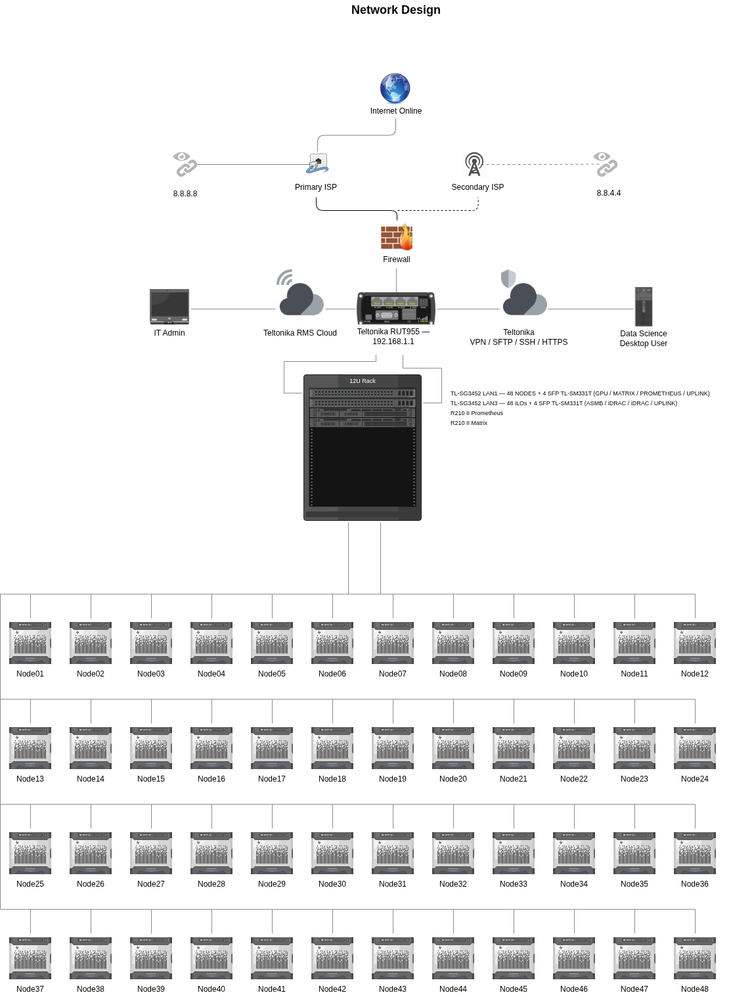
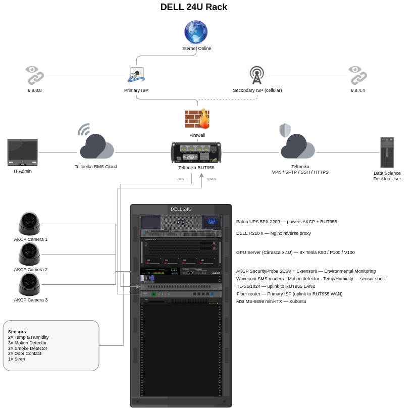

# Network

The AI Agent Farm's network as it is built: one router, three switches, one subnet (`192.168.1.0/24`), and no VLANs. The networks are kept apart by their own switches, on separate ports of the router.

## The router

A Teltonika RUT955 (`192.168.1.1`), at the window, inside the IP67 enclosure of its outdoor 4G antenna:

- **WAN:** the fibre box, in bridge mode, the primary Internet line;
- **4G:** the secondary line;
- **Teltonika RMS:** remote management of the Farm, even without a public IP address.

## The switches

| Router port | Switch | Rack | Connects |
|---|---|---|---|
| LAN1 | TP-Link TL-SG3452, **NODES** | 12U | NIC 1 of the 48 microservers; its 4 SFP modules: the GPU server, the Matrix server, the Prometheus server, the uplink |
| LAN3 | TP-Link TL-SG3452, **ILO** | 12U | the iLO of the 48 microservers; its 4 SFP modules: the GPU server's ASMB, the 2 iDRACs of the 12U rack, the uplink |
| LAN2 | TP-Link TL-SG1024 | Dell 24U | the machines of the 24U rack |

## The diagrams

### The 12U rack and the 48 nodes

12 columns of 4 microservers on pallets, around the 12U rack.

### The Dell 24U rack

The UPS, the nginx server (single entry from the Internet), the GPU server, the AKCP environmental monitoring, the TL-SG1024, the fibre box and the workstation.

The `.xml` files are the draw.io sources of the two diagrams.

## Datasheet

`datasheet/SDN-Gigabit-Managed-Switch.pdf`: the TP-Link datasheet of the TL-SG3452 switches.

## The book

*How to Build the AI Agent Farm with Claude Code* sets up this network in Chapter 4, and maps every address in Appendix D: <https://www.amazon.com/dp/B0HNQ2KCQB>.
